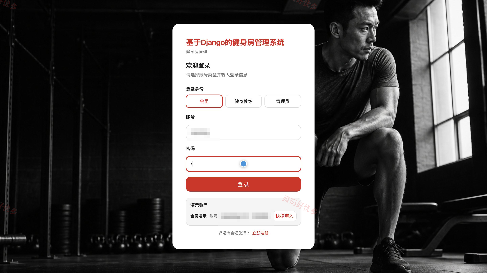
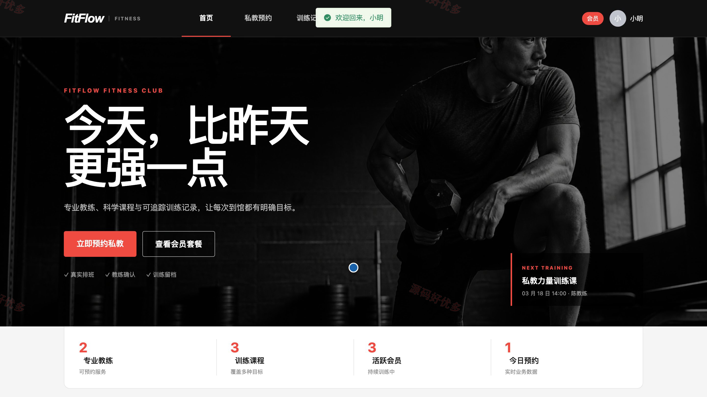
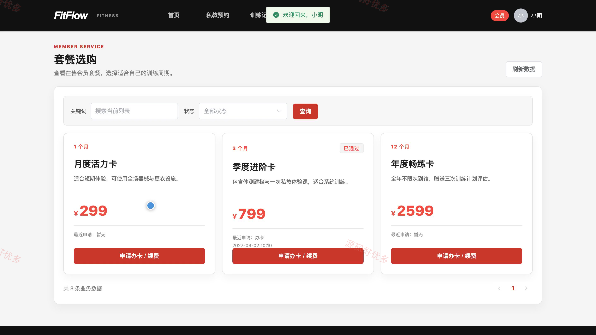
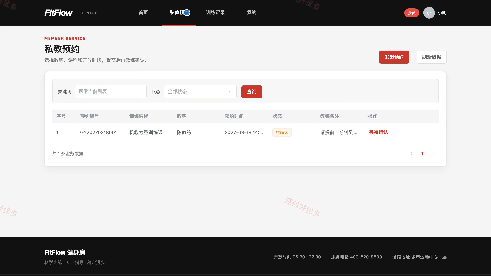
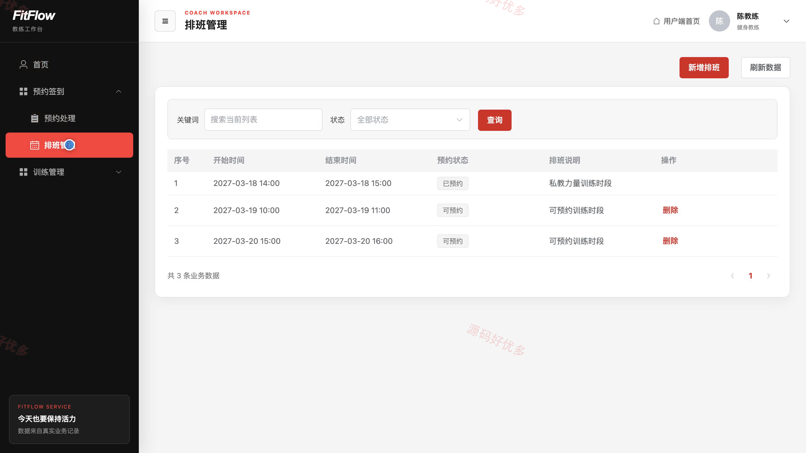
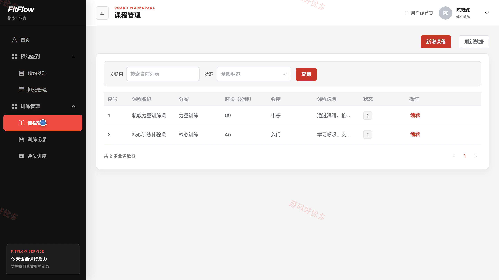
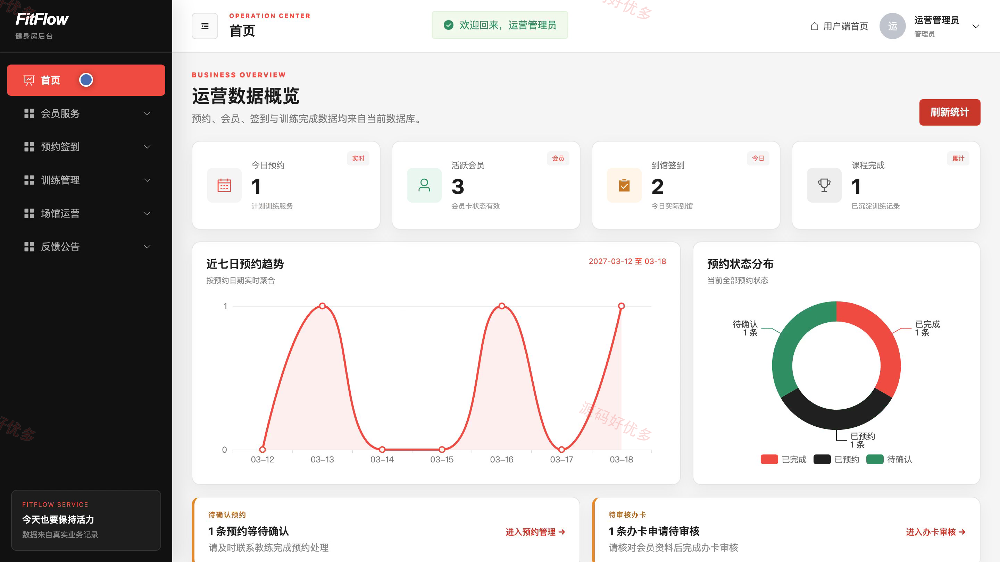
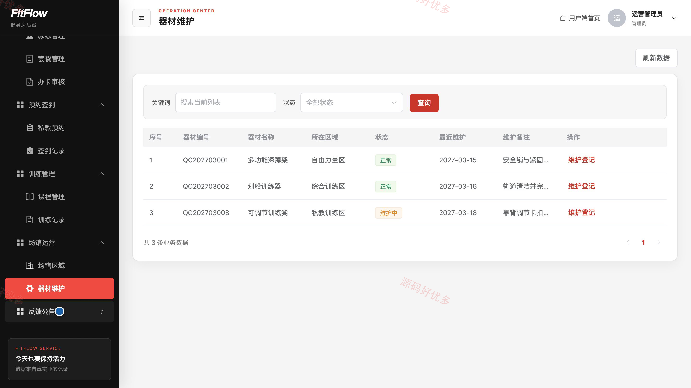

## 源码问题查看主页咨询

### 一、关键词
健身房运营、会员办卡、私教预约、到馆签到、训练记录

### 二、作品包含
源码+数据库+万字设计文档+PPT+全套环境和工具资源+本地部署教程

### 三、项目技术
前端技术： Html、Css、Js、Vue3.4、Element-Plus
后端技术：Python、Django

### 四、运行环境要求
开发工具：PyCharm + VSCODE

数据库：MySQL5.7+（共17张表）

数据库管理工具：Navicat10以上版本

环境配置软件： Python3+

前端Nodejs：16+

浏览器：谷歌浏览器

### 五、项目介绍
项目编号：bs040C

系统面向健身房会员、健身教练与管理员，支持会员套餐申请、私教预约、到馆签到、训练记录与意见反馈；教练可维护排班和课程、处理预约并记录会员训练进度；管理员负责会员服务、预约签到、场馆器材和运营内容管理。

角色：会员、健身教练、管理员

会员功能：注册登录与个人资料维护、会员套餐查看与办卡续费申请、私教课程与时段预约、到馆签到、训练记录与教练建议查看、场馆器材与服务意见反馈。

健身教练功能：个人资料与可预约状态维护、可预约训练时段排班、会员预约确认与处理、私教课程维护、训练完成记录填写、会员体重体脂与阶段进度记录。

管理员功能：运营数据概览、会员与教练管理、会员套餐管理、办卡与续费申请审核、私教预约与签到记录管理、课程与训练记录管理、场馆区域与器材维护、意见反馈与公告管理。

### 六、运行截图

